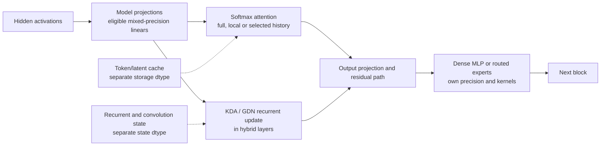
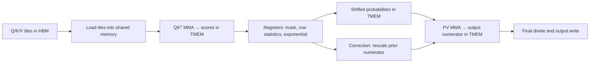

# Attention, sparse history and FlashAttention-4

**Evidence refreshed October 16, 2026 UTC.** This chapter explains the arithmetic and the kernel mechanisms. It distinguishes the March FA4 paper, the current standalone library, later low-precision work, and the interfaces exposed by serving engines. All performance numbers below are attributed upstream results; this atlas contains no reproduced B300 serving measurements.

## The decisions an attention implementation makes

Attention combines value vectors from the context, giving each a weight derived from a query–key score. Several independent choices determine its cost:

| Choice | What it changes | Examples |
| --- | --- | --- |
| Attention rule | Which query–key pairs participate | Full causal history, sliding window, learned top-k selection |
| State representation | What information is retained for later tokens | Ordinary K/V, MLA latent cache, compressed history, recurrent state |
| Cache placement | Where retained state is stored and addressed | Contiguous tensors, paged KV, sharded cache |
| Kernel implementation | How the required arithmetic is tiled and scheduled | FlashAttention, FlashInfer kernels, model-specific sparse kernels |
| Precision | Representation of operands, scales and accumulators | BF16, ordinary FP8, MXFP8, NVFP4 KV |

GQA shares K/V heads across query heads; MLA changes the retained representation and projection algebra. Neither name alone specifies sparse token selection. MoE sparsity concerns feed-forward experts and is a separate axis. KDA and GDN update recurrent state with a different attention formulation; replacing their update with ordinary softmax attention would change the model. See the [model comparison](comparison.md) and [memory accounting](memory-math.md).

This schematic shows where the choices enter a transformer block; the precise order, projections and residual operations are model-specific:

An NVFP4 export may quantize some of these linears while leaving others in FP8 or BF16. It does not make all Q/K/V operands, the cache or recurrent state four-bit. The [precision report](precision-and-kernels.md) and each model's precision page identify those boundaries.

### Dense, masked, token sparse and block sparse

**Dense attention** evaluates every pair allowed by its rule. In a causal language model this usually means all earlier tokens, not future tokens. A triangular causal mask still leaves quadratic prefill work. **Static masks**, such as a sliding window, select pairs from position rules. Whole tiles outside the rule can be skipped, while boundary tiles may still require element masks.

**Learned token sparsity** uses an indexer or selector to choose individual history positions. These indices need not form contiguous pages. A kernel can gather scattered tokens and pack their vectors into regular compute tiles. **Block sparsity** selects query/key blocks, which improves regularity but can retain unwanted elements inside a selected block. A block-sparse implementation may distinguish fully valid blocks from partially masked blocks. Current FA4 exposes these full/masked block lists explicitly. [ATTF-FA4-BLOCK-SPARSITY-PY](https://raw.githubusercontent.com/Dao-AILab/flash-attention/e9d8944c855489e03c66262d07ba4c81d9d8dd31/flash_attn/cute/block_sparsity.py), [ATTF-FA4-BLOCK-SPARSE-UTILS-PY](https://raw.githubusercontent.com/Dao-AILab/flash-attention/e9d8944c855489e03c66262d07ba4c81d9d8dd31/flash_attn/cute/block_sparse_utils.py).

These distinctions rule out “sparse attention always operates on pages or blocks.” The *semantic* selection can be at token granularity even when GPU work uses tiles. They also rule out describing every sparse mechanism as a summary of old tokens: some gather exact retained positions; some select compressed positions; recurrent mechanisms maintain a summary state. The model determines which of these is correct.

Dropping pairs changes the result relative to the corresponding unmasked dense operation. When the mask or selector is part of the trained architecture, a correct sparse kernel implements that architecture. The existence of a sparse kernel does not authorize applying an arbitrary sparse mask to a model trained with full attention. Likewise, merely supplying an element mask does not guarantee that the implementation skips the masked matrix multiplications.

### PagedAttention addresses storage

PagedAttention maps logical token blocks to physical KV blocks so a sequence need not occupy one contiguous allocation. It supports allocation and sharing of retained history. A dense causal query can still read **every** valid historical token through that page table. Paging alone does not select a smaller attention set or change the dense attention formula. [ATTF-PAGEDATTENTION](https://arxiv.org/abs/2309.06180v1).

A page is a storage unit; a sparse block is a unit of selected attention work; a compute tile is a unit of kernel execution. Their sizes can differ. They can be combined when the particular implementation supports the combination. For example, current standalone FA4 has separate `page_table`, `block_sparse_tensors` and `gather_kv_indices` arguments, but explicitly rejects **paged KV plus top-k gathered MLA** in that interface. Conceptual independence does not imply that every API combination exists. [ATTF-FA4-INTERFACE-PY](https://raw.githubusercontent.com/Dao-AILab/flash-attention/e9d8944c855489e03c66262d07ba4c81d9d8dd31/flash_attn/cute/interface.py).

## Exact attention without a full score matrix

For one head, let `Q` have `Nq` query rows, `K` have `Nk` key rows, and `V` have `Nk` value rows. The basic operation is

$$
S = QK^T/\sqrt{d} + M,\qquad P = \operatorname{softmax}_{\rm row}(S),\qquad O=PV.
$$

`M` supplies the mask, conventionally zero for an allowed pair and negative infinity for a forbidden pair. Biases or model-specific score transformations must also be preserved. For unequal query/key head layouts, GQA maps each query head to its corresponding shared K/V head.

A naive implementation writes the large `Nq × Nk` score/probability intermediates to HBM. FlashAttention instead loads tiles, computes local scores, updates compact row statistics and accumulates the output. It avoids materializing the full matrix in HBM while preserving the specified attention operation in exact arithmetic. Dense attention still performs quadratic pairwise work when both sequence dimensions grow. [ATTF-FLASHATTENTION](https://arxiv.org/abs/2205.14135v2).

### The online-softmax invariant

The following is an algebraic derivation for one query row. A vector of query rows applies it row by row. Maintain:

- `m`: the largest score seen so far;
- `l`: the sum of exponentials relative to `m`;
- `u`: the **unnormalized output numerator**, a value-width vector, in the same scale as `l`.

Initialize `m = −∞`, `l = 0`, `u = 0`. For the next key tile `J`, with scores `s_j` and values `v_j`, compute

$$
\begin{aligned}
m' &= \max(m,\max_{j\in J}s_j),\\
\alpha &= \exp(m-m'),\qquad p_j=\exp(s_j-m'),\\
l' &= \alpha l+\sum_{j\in J}p_j,\\
u' &= \alpha u+\sum_{j\in J}p_jv_j.
\end{aligned}
$$

After all tiles, return `O = u/l`. The first nonempty tile uses `α = 0`. Empty or fully masked rows require an explicit convention so `−∞ − (−∞)` is never treated as an ordinary subtraction; current FA4's no-sink convention produces zero output and `LSE = −∞`. [ATTF-FA4-SOFTMAX-PY](https://raw.githubusercontent.com/Dao-AILab/flash-attention/e9d8944c855489e03c66262d07ba4c81d9d8dd31/flash_attn/cute/softmax.py), [ATTF-FA4-BLOCK-SPARSE-UTILS-PY](https://raw.githubusercontent.com/Dao-AILab/flash-attention/e9d8944c855489e03c66262d07ba4c81d9d8dd31/flash_attn/cute/block_sparse_utils.py).

Why this works: after each tile, `l = Σ exp(s_j−m)` and `u = Σ exp(s_j−m)v_j` over all processed keys. Changing `m` multiplies both old sums by the same `α`; dividing cancels their common scale. A worked example makes the distinction from tilewise normalization clear. For scores `[0, ln 2]` and scalar values `[10, 20]`, processing one key per tile ends with `m=ln 2`, `l=1.5`, `u=25`, hence `O=16⅔`. Averaging independently normalized tile outputs would instead give `15` and would be wrong.

This formulation keeps `u` unnormalized throughout. An implementation that stores normalized output after each tile needs a different recurrence containing the old and new denominators. Mixing those two conventions is a mathematical error. Also, each tile's `p_j` here is a locally shifted exponential, not the final globally normalized probability.

“Exact attention” describes preservation of the attention rule and this algebra. Floating-point evaluation still has rounding, reduction-order, exponential-approximation and operand-conversion error; it need not be bitwise identical to a different implementation.

## What FA4 changes on datacenter Blackwell

### TMEM and asynchronous matrix multiplication

For the SM100-style path, tensor memory (TMEM) is a distinct on-chip store used by tensor-core operations. NVIDIA describes 128 lanes × 512 columns × 32 bits: **262,144 bytes = 256 KiB** at full capacity. A column therefore holds 512 bytes. Allocation is in 32-column units with power-of-two allocation sizes; allocated storage must be released. This is kernel scratch storage, not extra persistent KV capacity. [ATTF-PTX-TMEM](https://docs.nvidia.com/cuda/parallel-thread-execution/index.html#tensor-memory).

Fifth-generation `tcgen05.mma` operations accumulate into TMEM. The score and output accumulators can therefore reside outside the ordinary register file. Softmax still needs register-side work and explicit transfers. A matrix operation can proceed asynchronously while other warps load data or process a previous tile; barriers establish when operands or accumulators are safe to read or overwrite. Asynchronous issue removes a wait from the issuing thread, not the mathematical dependency between `QKᵀ`, softmax and `PV`. [ATTF-CUTLASS-TCGEN05](https://docs.nvidia.com/cutlass/4.5.2/media/docs/pythonDSL/mma_docs/tcgen05_programming.html).

An illustrative pipeline is:

Arrows show dependencies for one tile. The performance opportunity is to overlap independent work from different tiles. The author-described BF16 forward configuration alternates two 128-row query tiles and gives softmax and output correction different warpgroups. It stages probability stores to reduce register pressure. That is one concrete pipeline, not the definition of every FA4 kernel. [ATTF-FA4-BLOG](https://tridao.me/blog/2026/flash4/).

The pinned implementation chooses `q_stage=1` or `2`; for example, value head dimension 256 forces one query stage because two output tiles exceed the TMEM budget. It also has separate score ping-pong choices. Tile size, query stages, CTA pairing and scheduling must be read from the selected specialization. [ATTF-FA4-INTERFACE-PY](https://raw.githubusercontent.com/Dao-AILab/flash-attention/e9d8944c855489e03c66262d07ba4c81d9d8dd31/flash_attn/cute/interface.py), [ATTF-FA4-FLASH-FWD-SM100-PY](https://raw.githubusercontent.com/Dao-AILab/flash-attention/e9d8944c855489e03c66262d07ba4c81d9d8dd31/flash_attn/cute/flash_fwd_sm100.py).

### What 2-CTA execution means

A CTA is a CUDA thread block. In `CtaGroup.TWO`, two blocks in one cluster cooperate on a matrix tile: each owns part of the output/M dimension, and the B operand's shared-memory loading is divided across the pair. This can reduce redundant operand traffic. Both blocks must remain active while the operation uses their storage; TMEM operations and MMA must follow a consistent group mode. This is cooperation within a GPU, not tensor parallelism across two GPUs. [ATTF-CUTLASS-TCGEN05](https://docs.nvidia.com/cutlass/4.5.2/media/docs/pythonDSL/mma_docs/tcgen05_programming.html), [ATTF-PTX-TMEM](https://docs.nvidia.com/cuda/parallel-thread-execution/index.html#tensorcore-5th-generation-instructions).

FA4 uses the paired mode in selected forward and backward implementations. Its backward design can also combine work before global `dQ` reduction, reducing atomic traffic. That training optimization is not a decode speedup. Current forward dispatch explicitly gates 2-CTA use on geometry, masking, paging, split-KV and other features; ordinary block-sparse forward disables that generic 2-CTA path. [ATTF-FA4-FLASH-BWD-SM100-PY](https://raw.githubusercontent.com/Dao-AILab/flash-attention/e9d8944c855489e03c66262d07ba4c81d9d8dd31/flash_attn/cute/flash_bwd_sm100.py), [ATTF-FA4-INTERFACE-PY](https://raw.githubusercontent.com/Dao-AILab/flash-attention/e9d8944c855489e03c66262d07ba4c81d9d8dd31/flash_attn/cute/interface.py).

## Why softmax can hold up faster tensor cores

Matrix multiplication and exponentiation use different hardware resources. On B200, the authors' per-SM roofline uses 8,192 BF16 tensor operations/cycle, 16 exponential operations/cycle and 128 shared-memory read bytes/cycle. For `M=N=d=128`, the two forward matrix multiplies need an ideal 1,024 cycles, and the `M×N` exponentials also need 1,024 cycles. This explains why speeding only the matrix multiplies can expose softmax as the limiting stage; it is a simplified resource model, not a measured latency prediction. [ATTF-FA4-BLOG](https://tridao.me/blog/2026/flash4/).

### Split the exponential work between hardware and FMA

The SM100 implementation can send some exponentials through hardware `MUFU.EX2` and others through polynomial arithmetic on FMA units. For `2^x`, range reduction gives `x=n+f`, with integer `n` and `0≤f<1`, so `2^x=2^n·2^f`. A cubic approximation evaluates the fractional part in Horner form:

$$
2^f \approx 1+f\left(0.69514614+f\left(0.22756439+0.07711909f\right)\right).
$$

The implementation combines that approximation with exponent-bit manipulation, clamps the lower range and assumes a bounded upper range. It uses packed FMA operations for pairs of values. Only a selected fraction of row elements use this route; making every exponential software arithmetic can increase register pressure and latency. [ATTF-FA4-UTILS-PY](https://raw.githubusercontent.com/Dao-AILab/flash-attention/e9d8944c855489e03c66262d07ba4c81d9d8dd31/flash_attn/cute/utils.py), [ATTF-FA4-SOFTMAX-PY](https://raw.githubusercontent.com/Dao-AILab/flash-attention/e9d8944c855489e03c66262d07ba4c81d9d8dd31/flash_attn/cute/softmax.py).

This is an **approximation**, even though the tiling algorithm preserves exact attention algebra. Conversion of the intermediate probabilities to BF16 can dominate the extra approximation error for the evaluated inputs, but that observation does not establish unlimited precision or universal model-quality equivalence.

Softmax sensitivity depends on **relative** score errors. If quantization changes score `s_i` by `δ_i`, then the ratio of two attention probabilities changes by `exp(δ_i−δ_j)`. A common offset cancels exactly. Unequal errors can change close competitions or distort a small but useful probability tail, but every small error is not catastrophic. Errors in `QKᵀ` affect the attention weights; errors in the probabilities or `V` additionally affect their weighted sum. Their effect on a complete model requires quality evidence.

**B300 qualification:** the paper reports 32 exponential operations/cycle/SM for B300/GB300, twice B200's figure. Current `flash_fwd_sm100.py` recognizes the SM103 family and defaults software exponential emulation off there. It can also use `tcgen05.ld.red` for the row maximum when score/mask modifications and head geometry permit. Thus the B200 tuning explanation is not an instruction to enable polynomial exponentials on B300. [ATTF-FA4-PAPER](https://arxiv.org/html/2603.05451v1), [ATTF-FA4-FLASH-FWD-SM100-PY](https://raw.githubusercontent.com/Dao-AILab/flash-attention/e9d8944c855489e03c66262d07ba4c81d9d8dd31/flash_attn/cute/flash_fwd_sm100.py).

### Conditional rescaling keeps a persistent reference

Rescaling the whole accumulated output vector for every small increase in the maximum costs non-matmul work. FA4 can keep the current reference until a sufficiently large change requires rescaling. To make the invariant explicit, call that stored reference **`r`**, rather than confusing it with the exact running maximum `m` above.

For a new tile, let `c=max(r,max(tile scores))`. Choose `r'=c` when the threshold is exceeded, otherwise `r'=r`. Then use the same consistent recurrence:

$$
\alpha=\exp(r-r'),\quad
l'=\alpha l+\sum_j\exp(s_j-r'),\quad
u'=\alpha u+\sum_j\exp(s_j-r')v_j.
$$

If the reference is retained, `α=1`; the old output needs no scaling. Both the denominator and numerator still use the same reference. Final division `u/l` removes the common scale. It is not necessary for the stored reference to equal the true final maximum for that algebra to hold. Conversely, dividing by a denominator expressed relative to a different maximum would be incorrect unless the numerator is converted too.

The threshold compares the new scores with the **retained reference**, not merely with the previous tile's maximum. Several small increases therefore accumulate toward the threshold. For example, scores rising by three log2 units per tile eventually exceed an eight-unit reference gap; they are not allowed to drift upward forever because each adjacent jump is small. The source implements this by leaving `row_max` unchanged when it skips a rescale. [ATTF-FA4-SOFTMAX-PY](https://raw.githubusercontent.com/Dao-AILab/flash-attention/e9d8944c855489e03c66262d07ba4c81d9d8dd31/flash_attn/cute/softmax.py).

The pinned SM100 forward code uses an eight-unit **log2** threshold for 16-bit inputs, giving up to a factor of `2^8=256` of exponential scale slack. For FP8 inputs it instead uses zero threshold and an additional probability offset of eight log2 units. It checks that offset plus slack stays below the input format's finite range. This matters because overflow or saturation in converted probabilities cannot be repaired by a final denominator; neither can rounding or polynomial approximation error. The setting is an implementation-specific numerical tradeoff, not a promise of full precision for arbitrary inputs or precision formats. [ATTF-FA4-FLASH-FWD-SM100-PY](https://raw.githubusercontent.com/Dao-AILab/flash-attention/e9d8944c855489e03c66262d07ba4c81d9d8dd31/flash_attn/cute/flash_fwd_sm100.py).

## Python kernel source, compiled GPU execution

CuTe DSL expresses layouts, tiles, copies, matrix operations and synchronization in Python. It specializes and compiles kernels for GPU execution; Python is not interpreting each attention arithmetic operation on the GPU. `cute.compile` returns a reusable compiled executor, while the FA4 interface keys its own compilation cache by relevant specialization choices. New combinations can therefore incur compilation cost before their steady-state execution. NVIDIA documents both explicit compilation and JIT caching. [ATTF-CUTLASS-JIT](https://docs.nvidia.com/cutlass/latest/media/docs/pythonDSL/cute_dsl_general/dsl_jit_caching.html), [ATTF-FA4-INTERFACE-PY](https://raw.githubusercontent.com/Dao-AILab/flash-attention/e9d8944c855489e03c66262d07ba4c81d9d8dd31/flash_attn/cute/interface.py).

The authors report **20–30× faster compilation than their traditional C++ template approach**. Treat this as a development/build claim. It is not a 20–30× attention-runtime, cold-start or tokens-per-second result. Cache warmth, the number of specializations and the actual build remain relevant. [ATTF-FA4-PAPER](https://arxiv.org/html/2603.05451v1).

## Later MXFP8 attention needs scale scheduling too

The contraction axes differ: `QKᵀ` reduces over head features, whereas `PV` reduces over key-token positions. Block scales must match the operand orientation consumed by each matrix multiply. The September extension therefore gives `V` the appropriate sequence-axis scaling and converts the online probability tile to MXFP8 with compatible scales; it describes dynamic scaling of 32-element probability groups. These intermediate shifted exponentials need not be normalized into `[0,1]`, as the rescaling discussion explains. [ATTF-FA4-MXFP8](https://pytorch.org/blog/low-precision-flash-attention-4-end-to-end-block-scaled-attention-for-blackwell/).

Scale factors themselves consume TMEM. In the later public implementation's two-query-stage layout, score and output regions already occupy all 512 columns. The kernel reuses regions only after their contents are consumed: early QK scales use output space before outputs become live; later scales use drained score regions, with synchronization before reuse. This is a storage-lifetime and scheduling problem, not simply changing a BF16 type to FP8. That separate repository is pinned at `868a2dc7775a4c58194a9e3efd4f7b218c7a6df0`; its README labels the initial noncausal, head-dimension-128 MXFP8 API an unpublished release candidate. [ATTF-MX-FLASH-FWD-SM100-PY](https://raw.githubusercontent.com/facebookresearch/ads_model_kernel_library/868a2dc7775a4c58194a9e3efd4f7b218c7a6df0/lp_fa4/src/lp_fa4/cute/flash_fwd_sm100.py), [ATTF-MX-README-MD](https://raw.githubusercontent.com/facebookresearch/ads_model_kernel_library/868a2dc7775a4c58194a9e3efd4f7b218c7a6df0/lp_fa4/README.md).

## What the reported performance establishes

| Source and date | Reported result | Scope and limitation |
| --- | --- | --- |
| FA4 paper, arXiv **2603.05451v1**, March 5, 2026 | Up to **1,613 TFLOP/s**, about **71%** of stated BF16 peak; up to 1.3× cuDNN 9.13 and 2.7× Triton | Main text identifies B200 attention microbenchmarks with BF16, causal/noncausal shapes, lengths 1K–32K and fixed 32K total tokens. This is not B300 LLM serving throughput. |
| Author blog, March 5, 2026; retrieved October 16 | **1,605 TFLOP/s**, also described as 71% | Retain its different headline value. The blog says cuDNN 9.19.1.2 reaches similar performance after incorporating related optimizations; the 9.13 comparison is not a claim against every later cuDNN. |
| Meta authors' PyTorch article, September 16, updated September 23, 2026 | MXFP8 forward **2.85 PFLOP/s**; backward **1.82** with FP32 `dQ` accumulation or **1.98** with FP16 `dQ` accumulation | Internal FA4 extension on **Meta Recsys GB300 GPUs**, using LLM-shaped attention microbenchmarks. It compares an August 2 OSS snapshot, an internal BF16 fork and internal MXFP8 work. These are different precision and implementation conditions from the March result. |

Sources: [ATTF-FA4-PAPER](https://arxiv.org/html/2603.05451v1), [ATTF-FA4-BLOG](https://tridao.me/blog/2026/flash4/), [ATTF-FA4-MXFP8](https://pytorch.org/blog/low-precision-flash-attention-4-end-to-end-block-scaled-attention-for-blackwell/).

**Paper metadata discrepancy:** v1 Appendix A.1 instead names B100 180GB SXM6 (1000W) and March 2025. These conflict with its B200 main text and March 2026 submission. Preserve the inconsistency pending author clarification; the headline attribution above follows the main text. [ATTF-FA4-PAPER](https://arxiv.org/html/2603.05451v1).

The September work adds block-scaled operands, scale storage and conversion. Its described MXFP8 backward uses a **1-CTA** path. A separate GB300 recommendation-module comparison reports 1.00×–1.30× forward-plus-backward speedup across its stated KV lengths, illustrating that a faster attention kernel does not imply the same gain for a whole module. The article's particular training quality observations do not certify the eight atlas models. [ATTF-FA4-MXFP8](https://pytorch.org/blog/low-precision-flash-attention-4-end-to-end-block-scaled-attention-for-blackwell/).

TFLOP/s here counts attention arithmetic per kernel time. It does not report request throughput, prefill/decode latency, batching efficiency, memory capacity, or quality under this node's serving workload. The March BF16 path, current ordinary-FP8 API, later MXFP8 fork, FP4-weight GEMMs and NVFP4 KV caches are separate objects. An NVFP4 model export does not imply four-bit FA4 attention. See [precision and kernels](precision-and-kernels.md).

## Standalone library support versus engine integration

The source inspection below is pinned to Dao-AILab `flash-attention` **`e9d8944c855489e03c66262d07ba4c81d9d8dd31`**, retrieved October 16, 2026. Its standalone package is named `flash-attn-4`; this identity does not describe a serving engine's separately pinned fork or another package with FA4 in its name. [ATTF-FA4-PYPROJECT-TOML](https://raw.githubusercontent.com/Dao-AILab/flash-attention/e9d8944c855489e03c66262d07ba4c81d9d8dd31/flash_attn/cute/pyproject.toml).

| Path in this source | Established capability | Boundary |
| --- | --- | --- |
| SM100/SM103 | Compute-capability 10.x selects the SM100 family; B300-specific tuning exists inside it | Dtype, head dimensions, mask, paging, split and CTA choices still constrain the specialization |
| SM90 | Separate Hopper implementation | The SM100 TMEM explanation is not its implementation |
| SM120 | Separate forward class inherits the SM80-style `mma.sync` implementation and adjusts shared-memory checks | Its branch rejects paged KV, block sparsity and split-KV; ordinary FP8 forward is restricted to 10.x. This is not the B200 TMEM/`tcgen05` pipeline |
| Standard attention | Causal/local modes, score/mask callbacks and paged KV parameters | Support depends on architecture and combination; a mask callback does not itself establish tile skipping |
| Block-sparse attention | Explicit full/masked block metadata and dedicated traversal | Its block shapes and combinations are validated; it is not an automatic learned selector |
| Gathered sparse MLA | `gather_kv_indices` selects top-k positions through the `qv` absorbed-MLA route | This route requires value width 512, optional RoPE width 64, and gather width divisible by 128. It rejects local/custom mask, block sparsity and paged-plus-gather combinations in the inspected interface |

Sources: [ATTF-FA4-INTERFACE-PY](https://raw.githubusercontent.com/Dao-AILab/flash-attention/e9d8944c855489e03c66262d07ba4c81d9d8dd31/flash_attn/cute/interface.py), [ATTF-FA4-FLASH-FWD-SM120-PY](https://raw.githubusercontent.com/Dao-AILab/flash-attention/e9d8944c855489e03c66262d07ba4c81d9d8dd31/flash_attn/cute/flash_fwd_sm120.py), [ATTF-FA4-FLASH-FWD-SM100-PY](https://raw.githubusercontent.com/Dao-AILab/flash-attention/e9d8944c855489e03c66262d07ba4c81d9d8dd31/flash_attn/cute/flash_fwd_sm100.py).

This demonstrates why both “FA4 is only dense” and “FA4 runs the same Blackwell kernel everywhere” are too broad. It also does not mean that vLLM's generic `FLASH_ATTN` backend exposes every standalone feature. A model-specific adapter can implement different metadata conversion, cache preparation or phase dispatch. Check [vLLM's exact release and backend paths](../frameworks/vllm/SOURCE_REVIEW.md), [SGLang's paths](../frameworks/sglang/SOURCE_REVIEW.md), and the installed dependency identity. A library feature, engine selector entry and observed running kernel are three different kinds of evidence.

## Where these distinctions matter in the eight model families

This table reuses the linked architecture reports and their immutable model evidence. It identifies the operation that would need a compatible backend; it does **not** claim that the standalone FA4 API implements every row.

| Model | Attention/state in the atlas | Implication for an FA4 comparison |
| --- | --- | --- |
| [Kimi K3](../companies/moonshot-ai/kimi-k3/architecture.md) | 69 KDA layers and 24 gated MLA layers | Qualify MLA geometry and cache independently of recurrent KDA updates |
| [GLM 5.3](../companies/z-ai/glm-5.3/architecture.md) | MLA with a learned sparse indexer across the main backbone | Preserve selected token indices and the exact latent/position geometry; ordinary dense GQA dispatch is insufficient |
| [GLM 5.3 Flash](../companies/z-ai/glm-5.3-flash/architecture.md) | 34 KDA layers plus 11 NoPE sparse-MLA layers | Qualify sparse retrieval and recurrent state separately; a RoPE-bearing MLA specialization is not automatically applicable |
| [DeepSeek V4 Flash 0731](../companies/deepseek/deepseek-v4-flash-0731/architecture.md) | Recent-window and compressed selected history | Preserve compression and selection semantics; a generic page table does not describe the entire operator |
| [Qwen3.8 27B](../companies/alibaba-qwen/qwen3.8-27b/architecture.md) | 48 GDN layers and 16 gated full-attention layers | An attention-kernel improvement affects the compatible full-attention operations, not the GDN recurrence |
| [Qwen3.8 Flash Next](../companies/alibaba-qwen/qwen3.8-flash-next/architecture.md) | 36 GDN layers and 12 QSA layers | QSA's selected history and GDN's state need their own paths; the 2,048-token selection budget is not total cache capacity |
| [Gemma 4 31B IT](../companies/google/gemma-4-31b-it/architecture.md) | 50 local-window layers and 10 global layers, with different head dimensions | Check each layer's geometry and multimodal mask; global width 512 must not be mistaken for the special absorbed-MLA shape |
| [Mistral Medium 3.5](../companies/mistral-ai/mistral-medium-3.5/architecture.md) | 88 full-history GQA layers, head dimension 128 | Conventional GQA attention is the relevant comparison, with prefill and decode assessed separately |

Long prefill supplies many query rows and substantial matrix work. Decode supplies few query rows and reuses a growing history, making cache traffic and available parallelism different constraints. Sparse gathering adds index work and irregular reads; hybrid models also spend time in recurrent updates and feed-forward layers. Consequently, choose an attention backend by its supported model operation, phase, cache representation, precision and actual workload—not by the largest isolated-kernel FLOP/s headline. The [optimization guide](optimization.md) connects these choices to the node workload.
