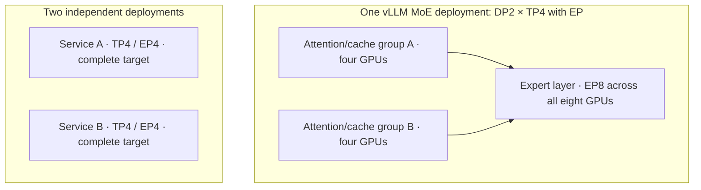

# Optimization on one 8×B300 node

## October 26 priorities

The current stable comparison is **vLLM v0.32.0 versus SGLang v0.5.22, deployed through KServe**. KServe v0.21.0 is the upstream reference; the installed controller, resource kind and runtime remain unknown. Release APIs, development branches and wheel indexes were checked again for this optimization follow-up. [Current identities](nightly-readiness.md#october-26-catalog-wide-recheck).

The first improvement is a trustworthy quality/latency baseline for the exact artifact. Next compare weight/cache precision, valid replica placement and speculation separately. Development changes below follow those controls; an open PR is an unmerged experiment, and a main-branch merge does not prove inclusion in an advertised nightly image. Each family has a matching `optimization_review` in the [model catalog](../catalog/models.json). Historical configurations retain their own release scope.

| Family | First useful stable comparison | Fresh insight and next decision |
| --- | --- | --- |
| [Kimi K3](../companies/moonshot-ai/kimi-k3/serving.md#october-26-optimization-and-benchmark-priorities) | Native MXFP4 TP8 target-only, then the matching engine-specific DSpark draft. Qualify NVIDIA mixed separately. | Open draft vLLM 63611 removes small-batch work in `latency_specialized`. Compare its isolated patch at small decode batches; its single-run author results do not establish a reliable gain. |
| [GLM 5.3](../companies/z-ai/glm-5.3/serving.md#october-26-optimization-and-benchmark-priorities) | Official FP8 TP8 versus two independent TP4 groups, matched context/cache and quality. | Merged SGLang Python templates can reduce host preprocessing for long tool histories. Require byte/token equivalence before measuring end-to-end benefit; retain the separate FP8/DCP8 exclusion. |
| [GLM 5.3 Flash](../companies/z-ai/glm-5.3-flash/serving.md#october-26-optimization-and-benchmark-priorities) | Official FP8 TP4/TP8 and replica placement, then native MTP. | Same merged template improvement, with Flash-specific media serialization. Measure recurrent/sparse-state and draft costs separately from CPU rendering. |
| [DeepSeek 0731](../companies/deepseek/deepseek-v4-flash-0731/serving.md#october-26-optimization-and-benchmark-priorities) | Exact native target-only versus bundled DSpark on a valid engine-specific TP/DP/EP layout. | Merged SGLang non-EP two-batch-overlap fix addresses DP-attention collectives and padding. Optional exact-0731 qualification must precede throughput claims; author tests use H200/V4 Flash. |
| [Qwen 27B](../companies/alibaba-qwen/qwen3.8-27b/serving.md#october-26-optimization-and-benchmark-priorities) | TP1 BF16, official FP8 and NVIDIA mixed weights with matched BF16 KV; then replicas. | SGLang MTP/state policy can change backend and page size. Record effective dispatch before attributing gains to drafting or quantization; keep FA4/BF16 and FlashInfer/FP8-cache comparisons separate. |
| [Qwen Flash Next](../companies/alibaba-qwen/qwen3.8-flash-next/serving.md#october-26-optimization-and-benchmark-priorities) | Official FP8 TP4+EP candidate; text-only graph/eager comparison before MTP and independent-group placement. | Open H200/main QSA retraction report motivates state-isolation checks before future P/D adoption. It does not establish a stable, B300 or colocated-serving defect. |
| [Gemma 31B](../companies/google/gemma-4-31b-it/serving.md#october-26-optimization-and-benchmark-priorities) | TP1 BF16 quality anchor versus exact weight exports; then the official separate assistant. | H512 NVFP4-cache proposal needs three unmerged PRs. Capacity may improve while FP8 materialization increases workspace/prefill cost; investigate only as an integration experiment. |
| [Mistral Medium](../companies/mistral-ai/mistral-medium-3.5/serving.md#october-26-optimization-and-benchmark-priorities) | FP8 TP8 reference versus qualified TP4/TP2 layouts; EAGLE separately. | Merged wrapper and open processor fixes motivate exact HF-layout text/image, cache-flush and startup checks. Small/Pixtral tests do not establish Medium 3.5 behavior. |

### Development evidence and applicability

**GLM preprocessing is the clearest new host-side candidate.** SGLang 45154 selects the Python template only when architecture and checkpoint template match, or when explicitly selected. A same-build comparison can explicitly supply the original Jinja template file as the control. Verify escaped tool arguments, reordered tool results, inline system messages and retained reasoning against the pinned publisher template. Image histories apply to Flash; the flagship is text-only. The source and release-ancestry comparison establish a post-release implementation, not a measured B300 improvement. [O26-GLM-TEMPLATE](https://api.github.com/repos/sgl-project/sglang/pulls/45154) [O26-GLM-TEMPLATE-SOURCE](https://raw.githubusercontent.com/sgl-project/sglang/ca473ef3e437461241de0f3f966406b3a5bd403b/python/sglang/srt/parser/python_chat_template.py) [O26-GLM-TEMPLATE-MANAGER](https://raw.githubusercontent.com/sgl-project/sglang/ca473ef3e437461241de0f3f966406b3a5bd403b/python/sglang/srt/parser/template_manager.py) [O26-GLM-TEMPLATE-ANCESTRY](https://api.github.com/repos/sgl-project/sglang/compare/v0.5.22...ca473ef3e437461241de0f3f966406b3a5bd403b?per_page=1).

**Cache/state correctness precedes higher concurrency.** Qwen issue 45864 reports missing QSA compressed-index and pending key/RoPE restoration after P/D retraction/slot reuse, using a small Qwen4-Exp configuration on H200/main. The useful test is exact-build restoration and request isolation under controlled pressure, followed by long-context task quality. DeepSeek overlap PR 33250 instead fixes the non-EP DP-attention path when attention-TP exceeds one; its merge is outside v0.5.22 ancestry. These are distinct mechanisms and neither supplies a generic DCP recipe. The open adaptive-DSpark consensus PR is another conditional collective-progress check, supported by MI355X/V4.1 author evidence rather than exact Kimi/0731 B300 reproduction. [O26-QSA-RETRACT](https://api.github.com/repos/sgl-project/sglang/issues/45864) [O26-DSV4-TBO](https://api.github.com/repos/sgl-project/sglang/pulls/33250) [O26-DSV4-TBO-ANCESTRY](https://api.github.com/repos/sgl-project/sglang/compare/v0.5.22...ef11eb3b76354ffbabd9f17a2343e79522e41cf2?per_page=1) [O26-DSPARK-CONSENSUS](https://api.github.com/repos/vllm-project/vllm/pulls/62769).

**Gemma's NVFP4-cache proposal is a capacity/quality tradeoff.** The proposed FlashInfer path combines H512 PrimTS decode with active-page FP8 materialization for prefill and clearing for mixed H256/H512 block layouts. Include temporary workspace in total HBM; cache bytes alone omit a material cost. The author reports both quality differences and workload-dependent speed/capacity results, so “near-lossless” or a universal speedup is unsupported. vLLM 62117 and FlashInfer 5720/6445 remain open; all three source heads are recorded in the lock. The separate E2B/RTX3090 MTP fast-prefill proposal does not establish target KV sharing for the 31B model. [O26-GEMMA-KV4](https://api.github.com/repos/vllm-project/vllm/pulls/62117) [O26-GEMMA-FI-5720](https://api.github.com/repos/flashinfer-ai/flashinfer/pulls/5720) [O26-GEMMA-FI-6445](https://api.github.com/repos/flashinfer-ai/flashinfer/pulls/6445) [Gemma-specific limits](../companies/google/gemma-4-31b-it/serving.md#october-26-optimization-and-benchmark-priorities).

### Benchmark decisions and measurement contract

The following are benchmark requirements and proposed comparisons. Harnesses, datasets, detailed run schedules and results belong in the separate execution repository. No serving benchmark was executed during this research update.

| Priority / question | Controlled comparison | Decision evidence |
| --- | --- | --- |
| P0: does the configuration preserve behavior? | Exact target/export/draft revision, fixed tokenizer/template and representative text/tools/media; include restart, cancellation and applicable cache/state reuse. | Load/dispatch, request isolation, tool validity, completion/truncation/errors and task quality. Byte-identical prompt/token checks apply to template replacements; quantized outputs instead need declared quality tolerances. |
| P1: where is one request slow? | Unique prompts with warm runtime and cold semantic prefix; short versus long prefill, then decode-heavy requests. Keep input/output distributions and EOS policy explicit. | CPU render/tokenize time, prefill, generated-token TTFT, first visible answer, first usable tool call, decode latency and total peak HBM. |
| P1: what load can the node sustain? | Same eight-GPU budget and finite offered arrival rates through the KServe route; compare valid independent replicas versus wider groups. | Queue-inclusive p50/p95/p99 latency with adequate samples, timeouts/errors, completed-request rate, SLO goodput and queue growth. Report whole-node results and CPU/host-memory use. |
| P2: does cache locality help chat? | Identical conversation histories versus changed-prefix controls; explicit cold/warm semantic cache, affinity policy and request skew. | Reused versus uncached input tokens, turn latency, eviction/retraction, cross-request isolation and replica imbalance. A single flush through a load balancer does not establish that every replica was flushed. |
| P2: does speculation improve useful work? | Target-only versus exact native or separate draft, one proposal-budget change at a time; fixed quality set and sampler. | Accepted length, draft/verification cost, state/rollback correctness, extra HBM and episode latency. Acceptance alone is insufficient. |
| P2: do coding/tools/media remain useful? | Same agent scaffold, tools, task environment and reasoning budget; same media bytes/processor/resolution where supported. | Completed tasks, correct tool actions, retries, truncation and full wall time including tools/tests. Token replay alone cannot measure task completion. |
| P3: which development change merits adoption? | Same build with an effective on/off control, or one pinned parent plus only the candidate patch and required dependencies. | Improvement in the actual bottleneck without quality/SLO regression. Stable-versus-main is a whole-build comparison and cannot isolate one PR. |

Record the engine **image digest and source/build identity**, kernel/library versions, GPU/rank groups, target/draft/export pins, tokenizer/processor/template, resolved cache/backend/page/state settings, scheduler/admission limits and request trace. A source commit or nominal flag is insufficient when the binary or model override changes effective behavior. Physical allocation must fit eight GPUs; TP/attention-DP/EP describe interacting groups, not three independent multipliers. [Topology interpretation below](#tp-ep-and-replicas-answer-different-questions).

**Use consistent clocks.** Capture scheduled arrival, client admission, HTTP dispatch, first generated-token event, first visible-answer event, first usable tool call, last token and terminal response. Empty role/control events are not generated tokens. Request TTFT starts at HTTP dispatch; queue-inclusive latency starts at scheduled arrival. Server-acceptance time requires separate instrumentation. A streaming chunk can contain several tokens, so inter-chunk latency is not automatically per-token latency. Preserve reasoning, visible-answer and tool payload accounting separately.

vLLM v0.32.0's current implementation is `vllm/benchmarks/serve.py`. It records client semaphore delay separately; `e2el_including_client_queue` is emitted when both finite request rate and maximum concurrency are configured. Its built-in goodput applies latency SLOs to successful requests and does not grade semantic quality. The Responses client times reasoning and visible delta events, while its accumulated generated text contains visible text; endpoint choice therefore affects accounting. SGLang v0.5.22 times chat reasoning/content events and can include final framing in streaming request latency. Recompute comparable metrics from equivalent event boundaries rather than comparing identically named columns blindly. [O26-V032-BENCH-SERVE](https://raw.githubusercontent.com/vllm-project/vllm/5df63a7203cdb9328d824a27b682e77c7b9928be/vllm/benchmarks/serve.py) [O26-V032-BENCH-REQUEST-FUNC](https://raw.githubusercontent.com/vllm-project/vllm/5df63a7203cdb9328d824a27b682e77c7b9928be/vllm/benchmarks/lib/endpoint_request_func.py) [S0522-F-BENCH](https://raw.githubusercontent.com/sgl-project/sglang/baa9befa381511cd4d56f83980951e5a45fffc6d/python/sglang/benchmark/serving.py).

Define **latency-SLO goodput** as successful requests satisfying the declared per-request latency budgets divided by elapsed wall time. Report semantic-quality outcomes separately, or label an explicit joint quality-and-latency rate when per-request grading exists. **Sustainable capacity** additionally requires bounded queue growth and the declared aggregate tail/error/quality limits. No application SLO or acceptable quality-loss margin has been supplied; choose those before execution, retain failures in the denominator, repeat paired comparisons and report uncertainty. A small run does not justify a precise p99 claim.

SGLang's agentic-trace replay normalizes messages to role/content, dropping tool-call fields, and combines generated reasoning/text for subsequent history; this is useful for traffic shape, not functional agent evaluation. Runtime warmup and cached conversation prefixes must be controlled separately. Count conversations, HTTP turns and generated tokens separately; no replay summary establishes completed coding tasks. [S0522-F-BENCH](https://raw.githubusercontent.com/sgl-project/sglang/baa9befa381511cd4d56f83980951e5a45fffc6d/python/sglang/benchmark/serving.py) [S0522-F-TRACE](https://raw.githubusercontent.com/sgl-project/sglang/baa9befa381511cd4d56f83980951e5a45fffc6d/python/sglang/benchmark/datasets/agentic_trace.py) [Release-specific harness caveats](sglang-v0522-upgrade.md).

### Quality benchmarks to pair with serving measurements

Use a small representative task set for initial configuration rejection, then a fixed larger set for finalists. These are benchmark selections, not adopted leaderboard scores. Pin each dataset revision/split, evaluator commit/image, prompt policy, sampler and grading rules before execution. Keep a representative application task set alongside public benchmarks.

| Capability | Benchmark candidate | Scope and required control |
| --- | --- | --- |
| Tool/function correctness | **BFCL V4**, including the relevant multi-turn/agentic categories | Keep tool schema, parser and native-function versus prompted mode fixed; grade arguments and task behavior, not JSON syntax alone. The official page supplies a reproducibility reference. [O26-QUALITY-BFCL](https://gorilla.cs.berkeley.edu/leaderboard.html) |
| Repository-level coding | **SWE-bench Verified** plus representative internal coding tasks | Verified is a human-filtered 500-task subset. Fix the agent scaffold, tools, repository environment and evaluator; report resolved tasks and whole-episode wall time. A trace replay or bare-model score is a different measurement. [O26-QUALITY-SWEBENCH](https://www.swebench.com/) |
| Long-context retention | **RULER** plus multi-turn/tool-history checks | Pin generated fixtures and seeds; measure across supported service lengths with room for output. Synthetic retrieval does not establish coding quality or usefulness at maximum advertised context. [O26-QUALITY-RULER](https://github.com/NVIDIA/RULER) |
| Multimodal reasoning | **MMMU-Pro** with a fixed variant/split and application image tasks | Use only artifacts with supported vision paths; fix original media, resizing/crops and processor. Do not apply this arm to text-only GLM flagship or DeepSeek 0731. [O26-QUALITY-MMMU](https://github.com/MMMU-Benchmark/MMMU) |

These quality arms can compare engines, exact weight/cache formats and speculative settings without inheriting publisher scores. Template/processor changes also need targeted protocol fixtures: an aggregate benchmark score can miss a rare malformed tool call or state-isolation error.

### Platform improvements and review boundary

Separate engine time from KServe routing and startup before changing GPU settings. Two new merged KServe development changes are relevant to measurement: tracing injection for compatible LLMInferenceService routing/tokenizer components, and a higher LLM controller CPU limit for reconciliation/TLS work. Both lie outside v0.21.0 ancestry. Tracing requires compatible presets and cooperating images; a controller upgrade alone does not activate it for old templates. The CPU change retains its request and changes default QoS assumptions; investigate only if throttled reconciliation is a measured startup bottleneck. [Platform source and tests to consider](../frameworks/kserve/ARCHITECTURE.md#october-26-measurement-and-startup-candidates).

Five research subagents examined model families and benchmark methodology; four cross-reviews challenged another family's findings, followed by two independent integration reviews and a benchmark-semantics recheck. The checks narrowed open-PR versus merged/stable claims, hardware and exact-artifact applicability, benchmark clocks and attribution. They are independent source reviews, not independent reproduction of upstream performance. The single [source registry](../evidence/sources.json) and [upstream lock](../evidence/upstreams.lock.json) hold retrieval metadata and PR heads; unmerged synthetic merge SHAs are not recorded as merged revisions.

## Earlier release-scoped analysis

**SGLang v0.5.22:** use the [release-scoped argument and experiment analysis](sglang-v0522-upgrade.md) for current DP semantics, model-specific gates and new candidates. Earlier source comparisons below retain their own release identities. Replica count, attention DP and context parallelism must be resolved against the selected engine release.

The useful configuration depends on **what the model stores, what each token computes, and what the application repeats**. This page keeps the reasoning and known constraints; executable benchmarks and results belong in the separate execution repository.

**Latest release comparison:** [vLLM v0.32.0 on B300](vllm-v032-upgrade.md) audits the October 18 release against the v0.31 baseline below. It identifies automatic changes, explicit candidates and changelog items that do not apply to these models/hardware. Machine-readable additions use `vllm_v032_b300_review`; historical settings remain version-scoped.

## Per-model priorities for vLLM v0.31.0 on B300

**Selected-source review: October 17, 2026.** All rows assume mandatory KServe and vLLM release commit `db9527a46873454610df6dbedf79a36d6bf1a7f6`. They identify the next useful comparison, not measured optimal configurations. Keep the actual image, model/export revision, task quality, workload and total eight-GPU allocation explicit. The machine-readable counterpart is `vllm_v031_b300_review` in each [model catalog](../catalog/models.json) entry.

| Model | First candidate | Next improvement | Main constraint |
| --- | --- | --- | --- |
| [Kimi K3](../companies/moonshot-ai/kimi-k3/serving.md) | Native MXFP4 TP8; one eight-GPU KServe model group. | Compare external Inferact DSpark for latency; native TP8+EP/MegaMoE for batching. | NVIDIA mixed is integration-unqualified, not proven blocked by open PRs. Old publisher patch imports removed classes; do not apply unchanged. New latency_specialized decoder is outside v0.31. Native MegaMoE is not interchangeable with NVFP4 kernels. |
| [GLM 5.3](../companies/z-ai/glm-5.3/serving.md) | Official FP8 TP8 reference versus two independent TP4 KServe replicas. | Compare RedHat or Inferact NVFP4 at TP4; native MTP 1/3/5 separately. | Match KV precision before attributing differences to the exporter. NVFP4 TP2 is only a memory probe; approximately 232 GB serialized weights/rank precede cache/workspace. DSA requires its sparse MLA path, not ordinary FA4. |
| [GLM 5.3 Flash](../companies/z-ai/glm-5.3-flash/serving.md) | Official FP8: two TP4 KServe replicas versus one TP8 group. | Investigate FP8 TP2 ×4 replicas, then RedHat mixed NVFP4 TP1 ×8 if runtime memory/kernels permit; MTP separately. | These narrower layouts are hypotheses. FP8 payload about 328 GB excludes TP1 full residency; mixed payload about 198 GB makes TP1 plausible, not guaranteed. Preserve NVFP4 main experts and FP8 MTP experts. |
| [DeepSeek V4 Flash 0731](../companies/deepseek/deepseek-v4-flash-0731/serving.md) | Native TP1/DP4+EP reference; compare DP8+EP as an eight-GPU adaptation. | Compare target-only with bundled DSpark; seven proposals are a recipe candidate, with explicit matching draft revision and sampling. | Use v0.31 indexer_kv_dtype=mxfp4, not obsolete use_fp4_indexer_cache. Default V4 FlashMLA uses packed fp8_ds_mla, not generic FP8/FA4. NVIDIA NVFP4 target-only TP8 is separate; its DSpark pairing remains unresolved. |
| [Qwen 3.8 27B](../companies/alibaba-qwen/qwen3.8-27b/serving.md) | TP1 per KServe replica; matched BF16, official FP8 and NVIDIA mixed comparisons. | FlashInfer/BF16 KV control; then FlashInfer/FP8 KV, FA4/BF16 KV and optional MTP 1/2/3. | Forced FlashAttention with hd256/FP8 KV is rejected. Pin native draft revision and use align with prefix caching. Match serialized token IDs/padding across export tokenizers; no measured FP8/NVFP4 winner. |
| [Qwen 3.8 Flash Next](../companies/alibaba-qwen/qwen3.8-flash-next/serving.md) | Official FP8 TP4+EP candidate; NVIDIA mixed TP8 is its separate publisher reference. | Compare two independent four-GPU KServe groups; isolate PLE placement, native MTP and explicit IndexShare. | TP4+DP2+EP creates expert world8, not two independent EP4 groups. PLE offload already defaults on. Custom QSA uses sparse Triton; generic FA4 rules do not transfer. Prefix MTP uses align, not all. NVIDIA prerequisite fixes are in v0.31. |
| [Gemma 4 31B IT](../companies/google/gemma-4-31b-it/serving.md) | TP1 per KServe replica; BF16 quality anchor versus exact FP8/NVFP4 exports. | Evaluate TRITON_FLASHINFER for mixed 256/512 head shapes; then the official separate assistant for decode latency. | Generic all-layer FA4 is unsuitable. Stable includes assistant support despite stale nightly-only recipe wording; method=mtp alone does not identify the separate assistant. Qualify quantized-target pairings independently. |
| [Mistral Medium 3.5](../companies/mistral-ai/mistral-medium-3.5/serving.md) | Publisher FP8 TP8 reference; investigate TP2/TP4 and corresponding independent replicas. | Compare target-only with official EAGLE, three proposals, separately pinned draft revision. | Stable contains EagleMistral; nightly is not required merely by old recipe wording. Omit draft max_model_len=65536 on a 32768 target, or reduce it: v0.31 rejects draft cap above target. TP1 and FP8 KV remain capacity/quality probes. |

Each family page and catalog entry links the supporting immutable implementation and publisher evidence. A source-supported optimization still requires exact-image qualification in the separate execution repository.

## Start with the limiting resource

| Limit | Why it appears | Optimization that may help | Cost or qualification question |
| --- | --- | --- | --- |
| Weight residency | All stored experts occupy memory even when few run per token | Quantized export; TP/EP placement; supported component offload | Exact mixed precision, scale layout, quality and transfer cost |
| Weight-read bandwidth | Low-concurrency decode repeatedly reads a large weight set | Lower-byte weights; wider sharding; effective speculation | Actual kernels and collectives may erase the gain |
| Prefill compute | Many input tokens are processed together | Efficient attention/GEMM backend; batching; supported context parallelism | Sparse/recurrent paths can restrict the available topology |
| KV/history capacity | Long histories and many active sequences retain attention state | Context/admission limits; supported cache precision; prefix reuse | Accuracy, cache scaling and model-specific state accounting |
| Recurrent-state capacity | Hybrid layers retain state and snapshots for reuse or rollback | State-pool sizing and applicable state-cache mechanisms | Tokens, sequences and saved snapshots consume different pools |
| Communication | TP reductions or MoE dispatch cross devices | Topology-aware rank placement; fewer ranks; balanced experts | Narrower placement can increase per-rank work or exceed HBM |
| Scheduling/queueing | Long prefills compete with interactive decoding | Chunked prefill, token budgets, batching and additional replicas | Fairness and total throughput can conflict with one-request latency |
| Agent reliability | A bad tool call or patch adds retries and context | Faithful templates/parsers, adequate reasoning and retained precision | A faster turn can produce a slower or failed complete task |

The [memory explanation](memory-math.md), [precision analysis](precision-and-kernels.md) and [engine reviews](../frameworks/DECISION.md) trace these mechanisms to specific architectures and implementations. These are possible mechanisms, not measured gains.

## Unique prompts, chat and coding agents

| Workload | What is reused | What to prioritize | Common mistaken conclusion |
| --- | --- | --- | --- |
| One unique prompt | Usually only a shared system/template prefix | Useful-answer latency, prefill versus decode cost, supported TP and precision | More replicas will accelerate the same single request |
| Many independent prompts | Weights and the warm runtime; little semantic prefix | Aggregate useful throughput within latency limits | The fastest single-request configuration is the best fleet layout |
| Multi-turn chat | Token-identical history and sometimes recurrent snapshots | Prefix/state correctness, session routing, cache capacity and turn latency | Prefix caching is durable conversation storage |
| Agentic coding | System/tools, repository context and previous turns | Correct tools/patches and whole-task wall time | Faster token generation necessarily completes more coding tasks |

For unique prompts, distinguish **runtime warmup** from a **warm semantic prefix**. Graph/compile preparation can be complete while the request's cache is cold. Repeated synthetic prompts can accidentally become cache-hit measurements. vLLM's benchmark documentation explicitly warns about this. [RR-BENCH-VLLM-CLI](https://raw.githubusercontent.com/vllm-project/vllm/fa75d3456d60a5ffe923818c4b495295675b38e1/docs/benchmarking/cli.md)

For chat, the application still sends or reconstructs conversation history. Changing an earlier turn, template, reasoning-retention policy or tool schema changes the reusable prefix. Affinity may preserve useful state but overload one replica; a cache-aware router needs compatible backend observations and an explicit load/health policy. [KServe integration](../frameworks/kserve/ARCHITECTURE.md)

For coding agents, preserve exact tool and reasoning serialization. Consider completion quality and episode wall time together. Tool calls can run concurrently, so adding model/tool/test durations can double-count overlapping work; wall time and a trace describe different aspects. A public coding score is evidence about that benchmark setup, not a speed prediction for the user's agent.

## TP, EP and replicas answer different questions

**Tensor parallelism** splits suitable operators across GPUs. It can reduce per-rank weight/work but introduces communication. **Expert parallelism** distributes experts and routes tokens to them; it may use an existing TP/DP world rather than multiplying its GPU count again. **Independent replicas** serve different requests and maintain separate caches. Data-parallel attention inside an EP model is not automatically a set of independent complete-model replicas.

On eight physical GPUs, feasible independent placements include 1×TP8, 2×TP4, 4×TP2 or 8×TP1 **only where the exact model implementation and memory allow them**. No equation establishes the winner. One request cannot use extra independent replicas to accelerate its own decode. Many concurrent requests may benefit from narrower replicas, but a wider instance can batch or use bandwidth more effectively.

The actual NVLink/NVSwitch and CPU/NUMA layout matters. Do not import the topology of a DGX B300 or Grace-based GB300 into the user's unspecified SXM6-AC node. [Hardware](../hardware/B300-8GPU.md)

### Two TP4 replicas and DP2 with TP4/EP are different layouts

In the inspected vLLM release, **MoE `DP=2, TP=4` with EP creates one expert group of eight ranks**. Attention is divided into two TP4 groups with separate request/cache state, but expert execution synchronizes across both groups. An idle attention group can still need dummy forwards while another group is active. Two independent four-GPU services instead each hold a complete model across their own TP4/EP4 group. “TEP4” is shorthand that needs this process-group definition; it is not a portable independent-replica flag. [TOPR-V-EP](https://raw.githubusercontent.com/vllm-project/vllm/db9527a46873454610df6dbedf79a36d6bf1a7f6/docs/serving/expert_parallel_deployment.md), [TOPR-V-DP](https://raw.githubusercontent.com/vllm-project/vllm/db9527a46873454610df6dbedf79a36d6bf1a7f6/docs/serving/data_parallel_deployment.md).

These are layer/group views of the same eight-GPU budget, not additional GPUs per box. The independent layout duplicates the complete expert set; the coupled layout can distribute it across eight ranks. They differ in memory, synchronization, failure scope and routing, so they cannot be assigned the same performance expectation.

SGLang's **ordinary DP controller**, with `enable_dp_attention` false, launches separate TP groups and advances GPU placement by `TP × PP` per replica. Its **DP-attention mode** instead partitions attention inside a shared TP world. Thus identical-looking DP/TP numbers can have different meanings across engines or modes. Resolve model/backend overrides and the effective mode before counting GPUs; never multiply EP as a third independent factor. [TOPR-S-DP](https://raw.githubusercontent.com/sgl-project/sglang/e00930c5489053f26d86b179cee0d087f846acbb/python/sglang/srt/managers/data_parallel_controller.py), [TOPR-S-DPATTN](https://raw.githubusercontent.com/sgl-project/sglang/e00930c5489053f26d86b179cee0d087f846acbb/python/sglang/srt/layers/dp_attention.py).

For the dense Qwen27/Gemma31 targets, TP1 replicas avoid cross-GPU target-layer collectives, but request routing, CPU work, cache locality and optional draft execution still cost time. vLLM's `max_num_seqs` applies **per DP rank**: eight ranks with a cap of 256 permit up to 2,048 scheduled sequences in that accounting, not 2,048 guaranteed maximum-context conversations. [TOPR-V-DP](https://raw.githubusercontent.com/vllm-project/vllm/db9527a46873454610df6dbedf79a36d6bf1a7f6/docs/serving/data_parallel_deployment.md), [cache-capacity arithmetic](memory-math.md#turning-an-fp8-cache-budget-into-token-slots).

## Family-specific optimization questions

| Family | Evidence-backed starting point | Unique prompt | Multi-turn chat | Coding agents |
| --- | --- | --- | --- | --- |
| [Kimi K3](../companies/moonshot-ai/kimi-k3/serving.md) | TP8, exact native or supported NVIDIA mixed export | Target bandwidth and compatible DSpark draft cost | KDA/MLA snapshots, rollback and cache reuse | Native versus derivative quality; engine-specific drafts; DFlash training/workload mismatch |
| [GLM 5.3](../companies/z-ai/glm-5.3/serving.md) | Native FP8 or exact NVFP4 exporter; TP8 reference, documented lower-TP alternatives | MLA/indexer backend, MTP and TP width | Sparse history, parser fidelity and replica routing | Compare exporters at the same quality; avoid attributing exporter/topology changes to engine alone |
| [GLM 5.3 Flash](../companies/z-ai/glm-5.3-flash/serving.md) | Exact hybrid-model recipe; TP4 candidate | KDA/sparse-MLA kernels and native MTP route | Recurrent and sparse pools, reuse boundaries | Mixed draft precision, multimodal/tools and reasoning policy |
| [DeepSeek 0731](../companies/deepseek/deepseek-v4-flash-0731/serving.md) | Native documented TP/DP/EP paths; NVIDIA derivative has separate TP8 evidence | Native DSpark and compressed attention | Exact July-31 encoding and compressed/SWA state | Target-only quality before derivative speculation; no V4.1 support transfer |
| [Qwen 27B](../companies/alibaba-qwen/qwen3.8-27b/serving.md) | TP1 BF16, official FP8 or exact NVIDIA mixed export | Precision/kernel choice; TP2 only a comparison | GDN snapshots plus full-attention cache; faithful template | Native MTP versus target-only, correct tools and reasoning serialization |
| [Qwen Flash Next](../companies/alibaba-qwen/qwen3.8-flash-next/serving.md) | Official FP8 vLLM TP4/EP candidate; separate NVIDIA TP8 recipe; SGLang exact-export B300 cells unverified | PLE placement, QSA constraints and MTP | Ngram, recurrent and sparse history costs; independent replicas versus shared EP | Retained thinking policy, explicit IndexShare and mixed MTP; no exporter substitution |
| [Gemma 31B](../companies/google/gemma-4-31b-it/serving.md) | TP1 base/FP8/NVFP4 references | Local/global attention and newly identified assistant | Heterogeneous cache plus template revision | Task-specific quantization quality, exact tool template and assistant pairing |
| [Mistral Medium](../companies/mistral-ai/mistral-medium-3.5/serving.md) | Publisher FP8 TP8 reference; narrower TP remains a capacity/performance question | Full-history KV and separate EAGLE cost | Context length, replica cache locality and vision | EAGLE embedding/head alignment, tools and complete-task quality |

Each linked serving page supplies the primary evidence and exact caveats. A documented topology is a known starting path, not proof that it is optimal on B300.

## Precision and speculation are component decisions

### Why faster GEMMs do not imply equally faster serving

NVFP4 can reduce the bytes and arithmetic cost of eligible linear and expert operations. FlashAttention reorganizes attention data movement and computation; sparse architectures additionally change which history entries are attended to. Lower-precision KV changes stored history. None of these removes the cost of every other component. [Numeric formats and execution](precision-and-kernels.md), [attention mechanisms](attention-and-fa4.md).

For a simple serial cost model, if a fraction $f$ of request time is improved by a factor $s$, the resulting speedup is

$$
S = \frac{1}{(1-f)+f/s}.
$$

For example, doubling a component responsible for 60% of time gives **1.43×**, not 2×, before adding conversion overhead or considering overlap. This is an illustrative calculation, not a measurement. Real serving also changes batching, communication overlap and the available cache when a format changes.

| Situation | Mechanism that may matter most | What limits the inference |
| --- | --- | --- |
| Short unique prompt, low concurrency | Weight traffic, GEMM shape, launch latency and draft cost | Quantization overhead or synchronization can dominate a small operation |
| Long unique prefill | Attention arithmetic/data movement and projection/FFN throughput | FA4 kernel results depend on head shape, mask, sequence length and GPU; they do not rank whole models |
| Long-context decode | History traffic, cache precision, selected-token count and indexer cost | Dense, sparse/compressed and recurrent layers have different costs; decode is not universally bandwidth-bound |
| Reused chat prefix | Avoided prefill plus locality of cached history/state | Prefix reuse does not eliminate reading needed history during later full-attention decode |
| Coding agent | All of the above plus tool/reasoning quality and time outside inference | A faster kernel can have little effect on an episode dominated by tools, tests or retries |

Keep the model's trained attention semantics fixed when comparing implementations. A dense model does not acquire a learned sparse indexer by selecting a different kernel, and a GDN/KDA layer does not become softmax attention by selecting FA4.

### When FP8 plus FA4 is a useful candidate

FP8 can be a useful intermediate choice when its exact export preserves the required task quality and reduces a material weight, activation or history cost. FA4 can improve eligible attention work. Calling the combination a universal “near-lossless sweet spot” goes beyond that evidence: the exporter, cache scales, attention implementation and workload determine both numerical behavior and speed. The [precision explanation](precision-and-kernels.md) separates these choices, and the [FA4 explanation](attention-and-fa4.md) traces the actual arithmetic.

| Workload condition | Why the combination may help | What remains a separate decision |
| --- | --- | --- |
| Long, uncached full-attention prefill | Efficient attention tiling and eligible FP8 arithmetic can reduce attention time | Head dimensions, mask, actual input dtype and projection/FFN cost |
| Low-concurrency decode | Lower-byte weights or history can reduce HBM traffic | Small GEMM efficiency, quantization work, launches and communication can dominate |
| Concurrent independent requests | Larger batches can improve matrix utilization and amortize some overhead | Queueing, admission, replicas and memory pressure; there is no universal concurrency-16 crossover |
| Chat with a long reused prefix | Prefix reuse avoids repeated prefill; compressed history may increase resident capacity | Page granularity, eviction and routing can matter more than peak prefill FLOP/s |
| Coding agent | Reduced inference time can shorten model turns | Tool correctness, reasoning quality and retries determine useful completed work |

These are mechanisms to investigate, not measured rankings. Prefill is often compute intensive and long-context decode often stresses bandwidth, but neither is **strictly** one kind of workload. Sparse indexing, recurrent updates, MoE routing, collective communication and CPU scheduling can set the limit. B300's higher exponential throughput changes one balance inside attention; it does not remove every softmax or serving bottleneck. See [hardware scope](../hardware/B300-8GPU.md) and [FA4's SM103-specific choices](attention-and-fa4.md).

The submitted claims of **30–40% lower SGLang TTFT**, **5–10% higher vLLM throughput**, or **50%+ from a runner switch** lack a matched, traceable experiment for these models on this node. They are not retained as engine-selection facts. Likewise, prefix-overlap percentages alone cannot establish a winner: matching pages, retained state, request arrival patterns and routing determine the reuse that is actually available. The [engine source reviews](../frameworks/DECISION.md) describe supported controls and their applicability.

An NVFP4 model name does not describe every tensor or operation. Keep separate: target weights, activations, KV/history, sparse-index state, recurrent state and draft weights/state. PLE tables, embeddings, shared experts, routers, heads and vision modules can stay at different precision. The loaded representation can also differ from on-disk packing. [Precision and kernels](precision-and-kernels.md)

Speculation replaces some sequential target steps with proposal and verification work. Its value depends on accepted length, draft cost, verification cost, extra memory and batching. A high acceptance ratio can still lose overall. Native MTP, bundled DSpark, an external DSpark draft, DFlash and EAGLE have different model/state contracts; a generic speculation flag does not make them interchangeable.

Target-only is the reference for understanding the change. Natural acceptance under the actual sampler matters. Extra draft memory can prevent a useful replica or shrink the history pool. A cache or rollback error matters even when isolated token throughput improves.

## Context, memory fractions and scheduling

Set the service context for the workload. The complete serialized input, tools/images/retained reasoning and requested output must fit the cap. A 128K input plus generated output does not fit a 128K service cap. Maximum advertised context is an architectural limit, not a recommended starting allocation.

Memory-utilization fractions are engine-specific budgeting inputs. They are not a hard partition or guaranteed operational reserve; explicit cache-size options and model-specific pools can alter their effect. `auto` cache dtype can be influenced by export metadata. Compare effective settings and actual state capacity, not equal numeric flags across engines. [vLLM controls](../frameworks/vllm/SOURCE_REVIEW.md), [SGLang controls](../frameworks/sglang/SOURCE_REVIEW.md)

Chunked prefill and batching manage competition among requests. Their benefit depends on prompt lengths, queue depth and the model's supported cache/state path. Disabling chunking is not a valid comparison if that implementation requires it. Async scheduling reduces some host overhead; it does not override model/backend incompatibilities.

## KServe's role on this node

**KServe is the required platform for this infrastructure.** Establish the baseline with colocated prefill/decode inside a KServe-managed workload, then compare engine, precision and topology candidates through the intended service path. Account for routing and queueing separately from engine execution. A single TP8 instance leaves no GPUs for a concurrent replacement; two TP4 instances likewise consume the node. Prefill/decode disaggregation needs model-specific state transfer and a total allocation that fits eight GPUs. [KServe architecture](../frameworks/kserve/ARCHITECTURE.md)

The research priority is to explain why a change could help and where it can fail. Benchmark implementation and results are maintained separately; this repository records no unmeasured speedup as fact.

## Additional v0.31 scheduling and measurement priorities

`--max-num-active-seqs` separates scheduler admission from `--max-num-seqs`, which also sizes runner buffers and graph capacity. The active limit must be no greater than the runner limit; lowering it can trade queue time for smaller decode batches without shrinking those buffers. Compare these limits only after choosing a valid model/backend/topology. `--prefill-schedule-interval` coordinates admission across data-parallel ranks; it is not a generic independent-replica setting. A nonzero `--long-prefill-token-threshold` limits competing long prefills, with a single-request exception. Streaming intervals change client-visible cadence as well as host work, so keep delivery metrics distinct from GPU generation. [B300V31-SCHEDULER](https://raw.githubusercontent.com/vllm-project/vllm/db9527a46873454610df6dbedf79a36d6bf1a7f6/vllm/config/scheduler.py).

For cache-heavy traffic, report **generated output tokens**, **uncached prefill tokens**, **reused prefix tokens**, and **total submitted tokens** separately. A cached-input-inclusive throughput figure cannot be interpreted as decode speed. Preserve the denominator: per GPU, per whole node and per successful task answer different questions. Distinguish runtime/graph warmup from semantic-prefix reuse, and separate traffic-replay efficiency from actual coding-task correctness.

The newly supplied AgentX/InferenceX numbers, harness version/commands and additional external Gemma/GLM draft pairings were not independently qualified in this bounded review. They remain research leads; the atlas does not adopt them as measured results or release-compatible configurations. The confirmed priorities above already cover topology, separate weight/cache precision, native or exact paired speculation, prefix/state correctness and workload-specific goodput. Detailed harnesses and measurements remain in the external execution repository.
