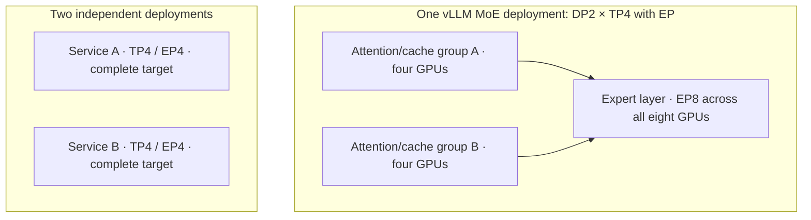

# Optimization on one 8×B300 node

The useful configuration depends on **what the model stores, what each token computes, and what the application repeats**. This page keeps the reasoning and known constraints; executable benchmarks and results belong in the separate execution repository.

## Start with the limiting resource

| Limit | Why it appears | Optimization that may help | Cost or qualification question |
| --- | --- | --- | --- |
| Weight residency | All stored experts occupy memory even when few run per token | Quantized export; TP/EP placement; supported component offload | Exact mixed precision, scale layout, quality and transfer cost |
| Weight-read bandwidth | Low-concurrency decode repeatedly reads a large weight set | Lower-byte weights; wider sharding; effective speculation | Actual kernels and collectives may erase the gain |
| Prefill compute | Many input tokens are processed together | Efficient attention/GEMM backend; batching; supported context parallelism | Sparse/recurrent paths can restrict the available topology |
| KV/history capacity | Long histories and many active sequences retain attention state | Context/admission limits; supported cache precision; prefix reuse | Accuracy, cache scaling and model-specific state accounting |
| Recurrent-state capacity | Hybrid layers retain state and snapshots for reuse or rollback | State-pool sizing and applicable state-cache mechanisms | Tokens, sequences and saved snapshots consume different pools |
| Communication | TP reductions or MoE dispatch cross devices | Topology-aware rank placement; fewer ranks; balanced experts | Narrower placement can increase per-rank work or exceed HBM |
| Scheduling/queueing | Long prefills compete with interactive decoding | Chunked prefill, token budgets, batching and additional replicas | Fairness and total throughput can conflict with one-request latency |
| Agent reliability | A bad tool call or patch adds retries and context | Faithful templates/parsers, adequate reasoning and retained precision | A faster turn can produce a slower or failed complete task |

The [memory explanation](memory-math.md), [precision primer](precision-and-kernels.md) and [engine reviews](../frameworks/DECISION.md) trace these mechanisms to specific architectures and implementations. These are possible mechanisms, not measured gains.

## Unique prompts, chat and coding agents

| Workload | What is reused | What to prioritize | Common mistaken conclusion |
| --- | --- | --- | --- |
| One unique prompt | Usually only a shared system/template prefix | Useful-answer latency, prefill versus decode cost, supported TP and precision | More replicas will accelerate the same single request |
| Many independent prompts | Weights and the warm runtime; little semantic prefix | Aggregate useful throughput within latency limits | The fastest single-request configuration is the best fleet layout |
| Multi-turn chat | Token-identical history and sometimes recurrent snapshots | Prefix/state correctness, session routing, cache capacity and turn latency | Prefix caching is durable conversation storage |
| Agentic coding | System/tools, repository context and previous turns | Correct tools/patches and whole-task wall time | Faster token generation necessarily completes more coding tasks |

For unique prompts, distinguish **runtime warmup** from a **warm semantic prefix**. Graph/compile preparation can be complete while the request's cache is cold. Repeated synthetic prompts can accidentally become cache-hit measurements. vLLM's benchmark documentation explicitly warns about this. [RR-BENCH-VLLM-CLI](https://raw.githubusercontent.com/vllm-project/vllm/fa75d3456d60a5ffe923818c4b495295675b38e1/docs/benchmarking/cli.md)

For chat, the application still sends or reconstructs conversation history. Changing an earlier turn, template, reasoning-retention policy or tool schema changes the reusable prefix. Affinity may preserve useful state but overload one replica; a cache-aware router needs compatible backend observations and an explicit load/health policy. [KServe integration](../frameworks/kserve/ARCHITECTURE.md)

For coding agents, preserve exact tool and reasoning serialization. Consider completion quality and episode wall time together. Tool calls can run concurrently, so adding model/tool/test durations can double-count overlapping work; wall time and a trace describe different aspects. A public coding score is evidence about that benchmark setup, not a speed prediction for the user's agent.

## TP, EP and replicas answer different questions

**Tensor parallelism** splits suitable operators across GPUs. It can reduce per-rank weight/work but introduces communication. **Expert parallelism** distributes experts and routes tokens to them; it may use an existing TP/DP world rather than multiplying its GPU count again. **Independent replicas** serve different requests and maintain separate caches. Data-parallel attention inside an EP model is not automatically a set of independent complete-model replicas.

On eight physical GPUs, feasible independent placements include 1×TP8, 2×TP4, 4×TP2 or 8×TP1 **only where the exact model implementation and memory allow them**. No equation establishes the winner. One request cannot use extra independent replicas to accelerate its own decode. Many concurrent requests may benefit from narrower replicas, but a wider instance can batch or use bandwidth more effectively.

The actual NVLink/NVSwitch and CPU/NUMA layout matters. Do not import the topology of a DGX B300 or Grace-based GB300 into the user's unspecified SXM6-AC node. [Hardware](../hardware/B300-8GPU.md)

### Two TP4 replicas and DP2 with TP4/EP are different layouts

In the inspected vLLM release, **MoE `DP=2, TP=4` with EP creates one expert group of eight ranks**. Attention is divided into two TP4 groups with separate request/cache state, but expert execution synchronizes across both groups. An idle attention group can still need dummy forwards while another group is active. Two independent four-GPU services instead each hold a complete model across their own TP4/EP4 group. “TEP4” is shorthand that needs this process-group definition; it is not a portable independent-replica flag. [TOPR-V-EP](https://raw.githubusercontent.com/vllm-project/vllm/db9527a46873454610df6dbedf79a36d6bf1a7f6/docs/serving/expert_parallel_deployment.md), [TOPR-V-DP](https://raw.githubusercontent.com/vllm-project/vllm/db9527a46873454610df6dbedf79a36d6bf1a7f6/docs/serving/data_parallel_deployment.md).

These are layer/group views of the same eight-GPU budget, not additional GPUs per box. The independent layout duplicates the complete expert set; the coupled layout can distribute it across eight ranks. They differ in memory, synchronization, failure scope and routing, so they cannot be assigned the same performance expectation.

SGLang's **ordinary DP controller**, with `enable_dp_attention` false, launches separate TP groups and advances GPU placement by `TP × PP` per replica. Its **DP-attention mode** instead partitions attention inside a shared TP world. Thus identical-looking DP/TP numbers can have different meanings across engines or modes. Resolve model/backend overrides and the effective mode before counting GPUs; never multiply EP as a third independent factor. [TOPR-S-DP](https://raw.githubusercontent.com/sgl-project/sglang/e00930c5489053f26d86b179cee0d087f846acbb/python/sglang/srt/managers/data_parallel_controller.py), [TOPR-S-DPATTN](https://raw.githubusercontent.com/sgl-project/sglang/e00930c5489053f26d86b179cee0d087f846acbb/python/sglang/srt/layers/dp_attention.py).

For the dense Qwen27/Gemma31 targets, TP1 replicas avoid cross-GPU target-layer collectives, but request routing, CPU work, cache locality and optional draft execution still cost time. vLLM's `max_num_seqs` applies **per DP rank**: eight ranks with a cap of 256 permit up to 2,048 scheduled sequences in that accounting, not 2,048 guaranteed maximum-context conversations. [TOPR-V-DP](https://raw.githubusercontent.com/vllm-project/vllm/db9527a46873454610df6dbedf79a36d6bf1a7f6/docs/serving/data_parallel_deployment.md), [cache-capacity arithmetic](memory-math.md#turning-an-fp8-cache-budget-into-token-slots).

## Family-specific optimization questions

| Family | Evidence-backed starting point | Unique prompt | Multi-turn chat | Coding agents |
| --- | --- | --- | --- | --- |
| [Kimi K3](../companies/moonshot-ai/kimi-k3/serving.md) | TP8, exact native or supported NVIDIA mixed export | Target bandwidth and compatible DSpark draft cost | KDA/MLA snapshots, rollback and cache reuse | Native versus derivative quality; engine-specific drafts; DFlash training/workload mismatch |
| [GLM 5.3](../companies/z-ai/glm-5.3/serving.md) | Native FP8 or exact NVFP4 exporter; TP8 reference, documented lower-TP alternatives | MLA/indexer backend, MTP and TP width | Sparse history, parser fidelity and replica routing | Compare exporters at the same quality; avoid attributing exporter/topology changes to engine alone |
| [GLM 5.3 Flash](../companies/z-ai/glm-5.3-flash/serving.md) | Exact hybrid-model recipe; TP4 candidate | KDA/sparse-MLA kernels and native MTP route | Recurrent and sparse pools, reuse boundaries | Mixed draft precision, multimodal/tools and reasoning policy |
| [DeepSeek 0731](../companies/deepseek/deepseek-v4-flash-0731/serving.md) | Native documented TP/DP/EP paths; NVIDIA derivative has separate TP8 evidence | Native DSpark and compressed attention | Exact July-31 encoding and compressed/SWA state | Target-only quality before derivative speculation; no V4.1 support transfer |
| [Qwen 27B](../companies/alibaba-qwen/qwen3.8-27b/serving.md) | TP1 BF16, official FP8 or exact NVIDIA mixed export | Precision/kernel choice; TP2 only a comparison | GDN snapshots plus full-attention cache; faithful template | Native MTP versus target-only, correct tools and reasoning serialization |
| [Qwen Flash Next](../companies/alibaba-qwen/qwen3.8-flash-next/serving.md) | Official FP8 vLLM TP4/EP candidate; separate NVIDIA TP8 recipe; SGLang exact-export B300 cells unverified | PLE placement, QSA constraints and MTP | Ngram, recurrent and sparse history costs; independent replicas versus shared EP | Retained thinking policy, explicit IndexShare and mixed MTP; no exporter substitution |
| [Gemma 31B](../companies/google/gemma-4-31b-it/serving.md) | TP1 base/FP8/NVFP4 references | Local/global attention and newly identified assistant | Heterogeneous cache plus template revision | Task-specific quantization quality, exact tool template and assistant pairing |
| [Mistral Medium](../companies/mistral-ai/mistral-medium-3.5/serving.md) | Publisher FP8 TP8 reference; narrower TP remains a capacity/performance question | Full-history KV and separate EAGLE cost | Context length, replica cache locality and vision | EAGLE embedding/head alignment, tools and complete-task quality |

Each linked serving page supplies the primary evidence and exact caveats. A documented topology is a known starting path, not proof that it is optimal on B300.

## Precision and speculation are component decisions

### Why faster GEMMs do not imply equally faster serving

NVFP4 can reduce the bytes and arithmetic cost of eligible linear and expert operations. FlashAttention reorganizes attention data movement and computation; sparse architectures additionally change which history entries are attended to. Lower-precision KV changes stored history. None of these removes the cost of every other component. [Numeric formats and execution](precision-and-kernels.md), [attention mechanisms](attention-and-fa4.md).

For a simple serial cost model, if a fraction $f$ of request time is improved by a factor $s$, the resulting speedup is

$$
S = \frac{1}{(1-f)+f/s}.
$$

For example, doubling a component responsible for 60% of time gives **1.43×**, not 2×, before adding conversion overhead or considering overlap. This is an illustrative calculation, not a measurement. Real serving also changes batching, communication overlap and the available cache when a format changes.

| Situation | Mechanism that may matter most | What limits the inference |
| --- | --- | --- |
| Short unique prompt, low concurrency | Weight traffic, GEMM shape, launch latency and draft cost | Quantization overhead or synchronization can dominate a small operation |
| Long unique prefill | Attention arithmetic/data movement and projection/FFN throughput | FA4 kernel results depend on head shape, mask, sequence length and GPU; they do not rank whole models |
| Long-context decode | History traffic, cache precision, selected-token count and indexer cost | Dense, sparse/compressed and recurrent layers have different costs; decode is not universally bandwidth-bound |
| Reused chat prefix | Avoided prefill plus locality of cached history/state | Prefix reuse does not eliminate reading needed history during later full-attention decode |
| Coding agent | All of the above plus tool/reasoning quality and time outside inference | A faster kernel can have little effect on an episode dominated by tools, tests or retries |

Keep the model's trained attention semantics fixed when comparing implementations. A dense model does not acquire a learned sparse indexer by selecting a different kernel, and a GDN/KDA layer does not become softmax attention by selecting FA4.

### When FP8 plus FA4 is a useful candidate

FP8 can be a useful intermediate choice when its exact export preserves the required task quality and reduces a material weight, activation or history cost. FA4 can improve eligible attention work. Calling the combination a universal “near-lossless sweet spot” goes beyond that evidence: the exporter, cache scales, attention implementation and workload determine both numerical behavior and speed. The [precision explanation](precision-and-kernels.md) separates these choices, and the [FA4 explanation](attention-and-fa4.md) traces the actual arithmetic.

| Workload condition | Why the combination may help | What remains a separate decision |
| --- | --- | --- |
| Long, uncached full-attention prefill | Efficient attention tiling and eligible FP8 arithmetic can reduce attention time | Head dimensions, mask, actual input dtype and projection/FFN cost |
| Low-concurrency decode | Lower-byte weights or history can reduce HBM traffic | Small GEMM efficiency, quantization work, launches and communication can dominate |
| Concurrent independent requests | Larger batches can improve matrix utilization and amortize some overhead | Queueing, admission, replicas and memory pressure; there is no universal concurrency-16 crossover |
| Chat with a long reused prefix | Prefix reuse avoids repeated prefill; compressed history may increase resident capacity | Page granularity, eviction and routing can matter more than peak prefill FLOP/s |
| Coding agent | Reduced inference time can shorten model turns | Tool correctness, reasoning quality and retries determine useful completed work |

These are mechanisms to investigate, not measured rankings. Prefill is often compute intensive and long-context decode often stresses bandwidth, but neither is **strictly** one kind of workload. Sparse indexing, recurrent updates, MoE routing, collective communication and CPU scheduling can set the limit. B300's higher exponential throughput changes one balance inside attention; it does not remove every softmax or serving bottleneck. See [hardware scope](../hardware/B300-8GPU.md) and [FA4's SM103-specific choices](attention-and-fa4.md).

The submitted claims of **30–40% lower SGLang TTFT**, **5–10% higher vLLM throughput**, or **50%+ from a runner switch** lack a matched, traceable experiment for these models on this node. They are not retained as engine-selection facts. Likewise, prefix-overlap percentages alone cannot establish a winner: matching pages, retained state, request arrival patterns and routing determine the reuse that is actually available. The [engine source reviews](../frameworks/DECISION.md) describe supported controls and their applicability.

An NVFP4 model name does not describe every tensor or operation. Keep separate: target weights, activations, KV/history, sparse-index state, recurrent state and draft weights/state. PLE tables, embeddings, shared experts, routers, heads and vision modules can stay at different precision. The loaded representation can also differ from on-disk packing. [Precision and kernels](precision-and-kernels.md)

Speculation replaces some sequential target steps with proposal and verification work. Its value depends on accepted length, draft cost, verification cost, extra memory and batching. A high acceptance ratio can still lose overall. Native MTP, bundled DSpark, an external DSpark draft, DFlash and EAGLE have different model/state contracts; a generic speculation flag does not make them interchangeable.

Target-only is the reference for understanding the change. Natural acceptance under the actual sampler matters. Extra draft memory can prevent a useful replica or shrink the history pool. A cache or rollback error matters even when isolated token throughput improves.

## Context, memory fractions and scheduling

Set the service context for the workload. The complete serialized input, tools/images/retained reasoning and requested output must fit the cap. A 128K input plus generated output does not fit a 128K service cap. Maximum advertised context is an architectural limit, not a recommended starting allocation.

Memory-utilization fractions are engine-specific budgeting inputs. They are not a hard partition or guaranteed operational reserve; explicit cache-size options and model-specific pools can alter their effect. `auto` cache dtype can be influenced by export metadata. Compare effective settings and actual state capacity, not equal numeric flags across engines. [vLLM controls](../frameworks/vllm/SOURCE_REVIEW.md), [SGLang controls](../frameworks/sglang/SOURCE_REVIEW.md)

Chunked prefill and batching manage competition among requests. Their benefit depends on prompt lengths, queue depth and the model's supported cache/state path. Disabling chunking is not a valid comparison if that implementation requires it. Async scheduling reduces some host overhead; it does not override model/backend incompatibilities.

## KServe's role on this node

KServe can manage service lifecycle, routing and integration with a Kubernetes platform. It does not create GPU capacity or replace the inference engine. A single TP8 instance leaves no GPUs for a concurrent replacement; two TP4 instances likewise consume the node. Prefill/decode disaggregation needs model-specific state transfer and a total allocation that fits eight GPUs. Begin with the engine's known behavior before adding orchestration. [KServe architecture](../frameworks/kserve/ARCHITECTURE.md)

The research priority is to explain why a change could help and where it can fail. Benchmark implementation and results are maintained separately; this repository records no unmeasured speedup as fact.
